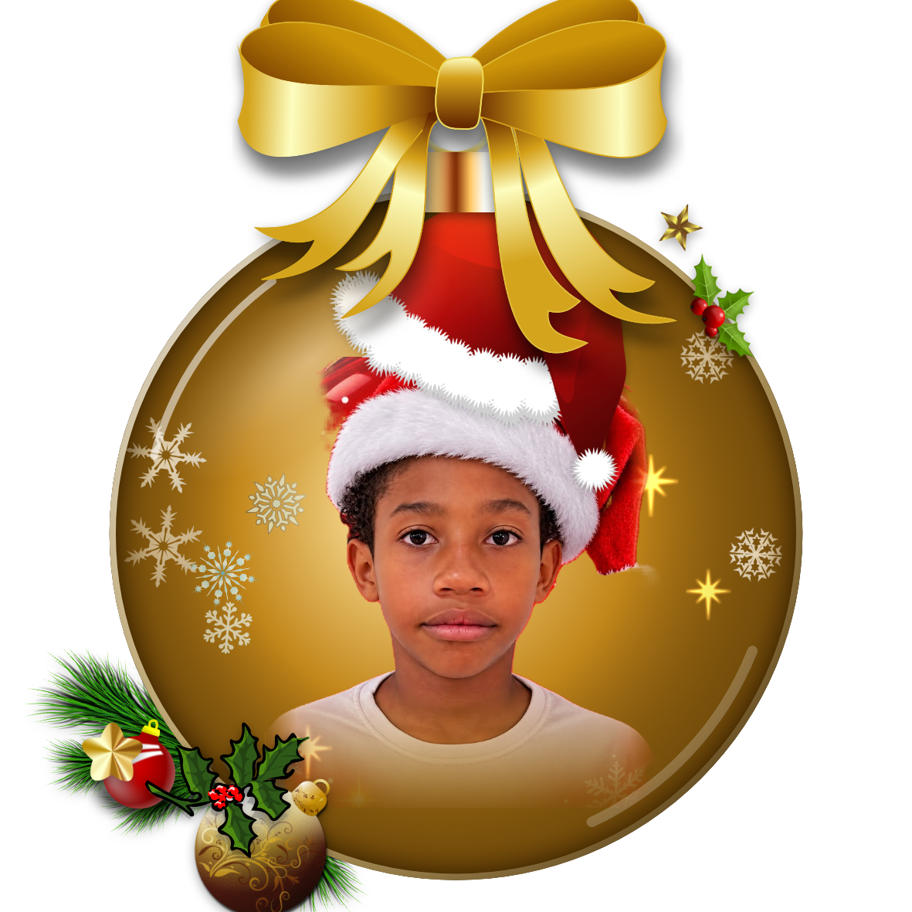

# 🎄 Bolinhas de Natal com Foto (5 × 5 cm, PNG transparente)

Aplicativo web estático que transforma fotografias em **bolinhas de Natal individuais**, no padrão da arte de referência: bola de vidro com laço, tampa dourada, flocos de neve, brilhos e arranjos natalinos. Tudo é montado com **assets gráficos profissionais de bibliotecas públicas**. Nenhum elemento decorativo é desenhado à mão no código nem gerado por IA.



## O que ele faz

- **Formato fixo de 5 × 5 cm**: exporta em 300, 600 ou 1200 DPI (591, 1181 ou 2362 px), com o DPI gravado no PNG (`pHYs`). Assim, a impressão sai exatamente com 5 cm.
- **Transparência real**: fora da bola e dos enfeites, o PNG fica 100% transparente (sem fundo branco nem xadrez simulado).
- **Recorte circular perfeito e simétrico**, com acabamento de vidro (aro, reflexo e sombreamento).
- **A foto original é preservada**: o rosto não é retocado, regenerado nem alterado. A detecção de rosto (MediaPipe) serve só para **enquadrar**, **proteger o rosto** (nenhum enfeite pode cobri-lo) e posicionar o gorro.
- **Recorte de fundo opcional** (segmentação de pessoa): troca o fundo da foto pelo vidro colorido da bola, com dissolução suave na parte de baixo, como no exemplo.
- **Cada foto ganha uma composição própria**: 6 modelos (Clássico, Arranjo de canto, Arranjo na base, Guirlanda, Fita dourada e Presentes), 6 temas de cor, espelhamento e sorteio de assets. Os assets menos usados no lote têm prioridade, então as artes não se repetem.
- **Ajustes por foto**: modelo, tema, zoom, arrastar para reposicionar, gorro, fundo de vidro e "Nova composição".
- **Exportação**: PNG individual, ZIP com todas e **folha A4** com 15 bolinhas de 5 cm para impressão.

## Biblioteca de assets incluída (62 elementos)

| Categoria | Exemplos |
|---|---|
| Laços | laço de cetim vermelho realista, laços dourados metálicos |
| Ramos de pinheiro e pinhas | ramos detalhados, ramo com pinhas, pinha dourada |
| Guirlandas | guirlanda de azevinho, guirlanda clássica com laço |
| Estrelas | estrelas metálicas douradas e prateadas |
| Flocos de neve | 9 flocos detalhados (brancos, cristal, dourado) |
| Presentes, sinos, bolas | presentes com fita de cetim, sinos dourados, bolas ornamentadas (incluindo renders 3D da ambientCG) |
| Flores e folhas | bico-de-papagaio (poinsétia), azevinho, visco |
| Fitas, brilhos e detalhes metálicos | fita dourada esvoaçante, faixas, brilhos, tampa dourada |

Fontes: **Openclipart** (CC0) e **Wikimedia Commons** (CC0 ou domínio público, incluindo itens da Pixabay e da ambientCG). Os SVGs originais ficam em `assets/_source_svg/`. A lista completa, com autor e link, está em [CREDITS.md](CREDITS.md) e no botão **Créditos e licenças** do app.

### Adicionar assets do Freepik, Flaticon, SVG Repo, Icons8, Pixabay e OpenMoji

Esses sites exigem login, chave de API ou licença própria, então os arquivos não podem ser redistribuídos aqui automaticamente. Há duas formas de usá-los:

1. **No navegador:** abra **Biblioteca de assets** e clique em **Importar arquivos**. Escolha a categoria, a fonte, a cor e a licença. Os arquivos ficam salvos no navegador (IndexedDB) e entram nas composições.
2. **No repositório:** coloque os PNG/SVG em `assets/<categoria>/` com o prefixo da fonte (por exemplo, `assets/bow/freepik-laco-cetim.png`) e rode:

   ```bash
   node tools/build-manifest.mjs
   ```

   O manifesto e o `CREDITS.md` são atualizados. Para informar autor, licença, link e cor, use `assets/<categoria>/sources.json`.

Categorias: `bow, pine, wreath, star, snowflake, gift, bell, ball, leaves, flower, ribbon, sparkle, pinecone, cap, hat`.
Na Biblioteca, também dá para **desligar** qualquer asset que você não queira usar.

> ⚠️ Respeite a licença de cada site. Freepik, Flaticon e Icons8 exigem atribuição no plano gratuito; para uso comercial sem crédito, é preciso ter o plano Premium.

## Publicar no GitHub Pages

```bash
git init && git add . && git commit -m "Bolinhas de Natal com foto"
git branch -M main
git remote add origin https://github.com/SEU-USUARIO/bolinhas-natal.git
git push -u origin main
```

Depois, no GitHub, vá em **Settings → Pages → Deploy from a branch → main / (root)**. O arquivo `.nojekyll` já está incluído.

Para testar localmente, use um servidor (o app não funciona abrindo o `index.html` direto, por causa do `fetch` do manifesto):

```bash
npx serve .        # ou: python3 -m http.server 8080
```

## Estrutura

```
index.html            interface
css/styles.css        estilo
js/app.js             fluxo, cartões, exportação
js/composer.js        motor de composição (modelos, temas, proteção do rosto, variação)
js/renderer.js        canvas: foto, vidro, camadas de assets
js/vision.js          detecção de rosto + recorte de pessoa (MediaPipe, via CDN)
js/export.js          PNG com DPI, ZIP e folha A4 (sem dependências)
js/assets.js          biblioteca (manifesto + importados)
assets/               PNGs por categoria + manifest.json + SVGs originais
tools/build-manifest.mjs
```

## Privacidade

As fotos são processadas **somente no navegador**. Nada é enviado para servidores. Só os modelos do MediaPipe são baixados do CDN. Sem internet, o app continua funcionando, mas sem detecção de rosto nem recorte de fundo, e o enquadramento passa a ser manual.

## Licença

O código é MIT. Os assets mantêm as licenças listadas em `CREDITS.md`.
